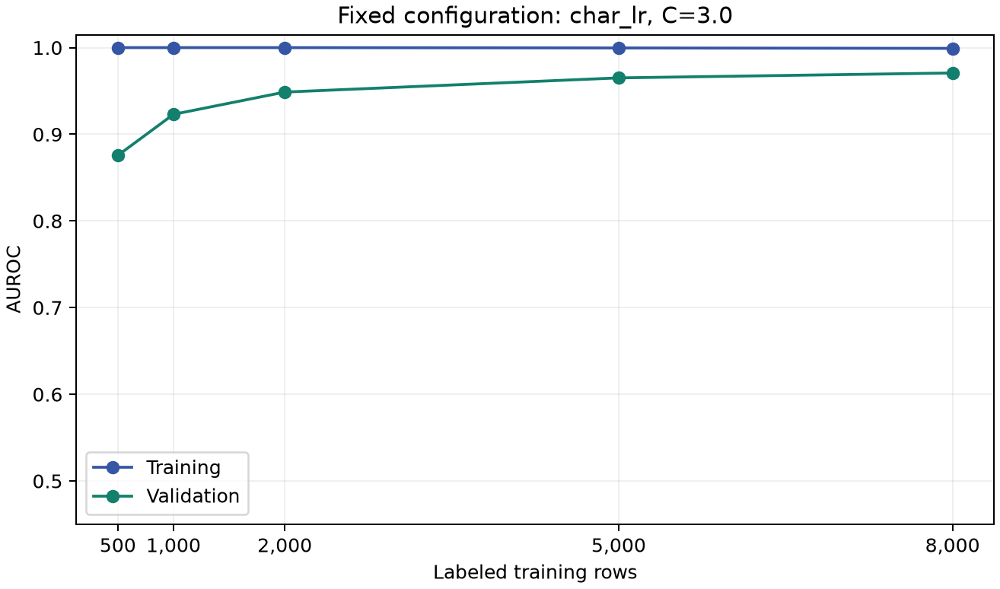

# Day 1 measured report — Q1 and Q2

The supplied training file contains 10,000 passages with 5,000 labels per class and no blank or exact duplicated passages. We saved one stratified 8,000/2,000 split with seed 20261023, including ordered IDs and input hashes. Both partitions are balanced. The starter file is a subset and was not added. All fitted preprocessing uses only the training partition. The holdout is reused for model selection, so the winning AUROC is a selection estimate, not an unbiased independent test score. The full-corpus audit found no word-trigram Jaccard pairs at or above 0.70, but a few shared openings/moderate-overlap pairs cross the split. We retain the prescribed holdout and report a secondary score excluding eight validation rows that share the normalized first 80 characters or word-trigram Jaccard similarity of at least 0.50 with a training passage. This leaves 1,992 rows (998 human, 994 AI); it does not certify source independence.

## Q1.1 — Preprocessing and representations

Word features use lowercase word unigrams/bigrams with the default scikit-learn token rule (at least two word characters), min_df=2 and a 60,000-feature cap. Character features use lowercase character 3-5 grams, min_df=3 and an 80,000-feature cap. Both use sublinear term frequency, smoothed IDF and L2 normalization. We retain stop words, punctuation in character features, and original formatting for structure experiments; we do not stem or infer semantic quality. The actual corpus mixes recipes, news, abstracts and informal posts, motivating both lexical and subword/formatting representations. Logistic regression uses liblinear and max_iter=2000. The SVM uses three seeded training-only folds for sigmoid calibration; vocabulary/IDF are shared across those internal folds but never fit on the outer holdout. Fit times include preprocessing and use two numerical-library threads.

## Q1.2 — Model comparison

We compared word logistic regression, character logistic regression, word Complement Naive Bayes and a calibrated linear SVM.

| Run | Setting | Train AUROC | Validation AUROC | Fit seconds |
| --- | --- | --- | --- | --- |
| word_lr_C0p3 | C=0.3 | 0.9766 | 0.9236 | 1.98 |
| word_lr_C1 | C=1.0 | 0.9943 | 0.9357 | 1.84 |
| word_lr_C3 | C=3.0 | 0.9998 | 0.9412 | 1.89 |
| char_lr_C0p3 | C=0.3 | 0.9793 | 0.9554 | 8.25 |
| char_lr_C1 | C=1.0 | 0.9934 | 0.9666 | 8.49 |
| char_lr_C3 | C=3.0 | 0.9991 | 0.9708 | 9.00 |
| word_nb_alpha0p1 | alpha=0.1 | 0.9945 | 0.8980 | 1.76 |
| word_nb_alpha1 | alpha=1.0 | 0.9825 | 0.8988 | 1.90 |
| word_nb_alpha3 | alpha=3.0 | 0.9699 | 0.8959 | 1.74 |
| word_svm_C1 | C=1.0 | 1.0000 | 0.9432 | 1.87 |

### Related-text sensitivity (diagnostic only)

| Run | Retained validation rows | Sensitivity AUROC |
| --- | --- | --- |
| word_lr_C0p3 | 1992 | 0.9232 |
| word_lr_C1 | 1992 | 0.9353 |
| word_lr_C3 | 1992 | 0.9409 |
| char_lr_C0p3 | 1992 | 0.9552 |
| char_lr_C1 | 1992 | 0.9664 |
| char_lr_C3 | 1992 | 0.9706 |
| word_nb_alpha0p1 | 1992 | 0.8973 |
| word_nb_alpha1 | 1992 | 0.8982 |
| word_nb_alpha3 | 1992 | 0.8954 |
| word_svm_C1 | 1992 | 0.9428 |

## Q1.3 — Tuning and selection

Before inspecting any model validation score, we fixed C in {0.3,1,3} for word and character logistic regression and alpha in {0.1,1,3} for ComplementNB. The calibrated SVM is an additional fixed C=1 comparison. Maximum validation AUROC selects each family winner and the overall Day 1 configuration, with the first listed candidate breaking exact ties. Log loss and source-overlap sensitivity are diagnostics and do not select the model. We did not consult Kaggle scores or hidden labels. All ten candidates are shown, including weaker settings. Within-family choices: word_lr: C=3.0; char_lr: C=3.0; word_nb: alpha=1.0; word_svm: C=1.0.

## Q1.4 — Day 1 recommendation

The Day 1 core recommendation is Character TF-IDF + logistic regression (C=3.0): training AUROC 0.9991, validation AUROC 0.9708, fit time 9.00 seconds. The validation log loss is 0.2817. Excluding the eight overlap-flagged passages leaves 1992 validation rows and sensitivity AUROC 0.9706; this does not establish complete source independence. The saved selected_config.json preserves this configuration. This is a provisional recommendation for the final submission, based on the declared selection metric and measured laptop cost. The gap to other candidates does not establish stability across domains or generators. The handwritten-hypothesis ablations are separate controlled comparisons; later final-model changes must be recorded explicitly. No private or public Kaggle score is claimed. After the core comparison, we tested one equal-weight average of character C=3 and word-plus-style C=1, without searching weights. Its validation AUROC is 0.9782 (change +0.0074; exploratory paired 95% interval [+0.0040, +0.0112]). The overlap-excluded AUROC is 0.9780 on 1992 rows. This blend is the Day 1 handoff recommendation; the character model remains the simpler fallback. This adaptive extension reused the validation set after earlier selections; its interval is not confirmatory. The required learning curve remains for the fixed character model.

## Q2.1 — Fixed-configuration learning curve

Configuration: `{'kind': 'char_lr', 'C': 3.0}`. Subset IDs are saved; every size refits vocabulary and IDF.

| Training rows | Train AUROC | Validation AUROC | Fit seconds |
| --- | --- | --- | --- |
| 500 | 1.0000 | 0.8757 | 0.58 |
| 1000 | 1.0000 | 0.9230 | 1.11 |
| 2000 | 1.0000 | 0.9487 | 2.19 |
| 5000 | 0.9996 | 0.9651 | 5.61 |
| 8000 | 0.9991 | 0.9708 | 9.22 |

## Q2.2 — Curve

## Q2.3 — Interpretation

Validation AUROC changes from 0.8757 at 500 rows to 0.9708 at 8,000 rows (+0.0951); the 5,000-to-8,000 change is +0.0057. The final training-minus-validation gap is +0.0284. The positive gap is consistent with overfitting, although sampling and source variation can contribute. The overall validation increase supports using the available labeled examples for this configuration. Each size uses one nested stratified sample and one seed, with preprocessing refit on that sample. We held hyperparameters and the 2,000 validation IDs fixed. The curve does not quantify sampling variability or justify extrapolating beyond the supplied data. High training performance with lower validation performance suggests a generalization limitation rather than evidence that a larger-capacity model alone is needed.

## Additional notebook hypotheses — exploratory controlled tests

The actual training audit motivated tests of repetition, formatting and sentence structure. Positivity/adjective/personalization differences were weak or opposite to the suggested direction. POS annotations are predictions of a disclosed pretrained NLTK English tagger, not grammar truth. All ablations use C=1; word/style features have fixed weights 1 and 0.1. The class-conditional POS model is a smoothed trigram model with three-fold cross-fitted training features. It is not a neural network or an error detector. Reported resubstitution training AUROC for this model uses final all-training tag models and is optimistic. Cache reuse makes bonus timing order dependent.

| Approach | Train AUROC | Validation AUROC | Fit seconds |
| --- | --- | --- | --- |
| style_lr | 0.9012 | 0.9060 | 30.05 |
| pos_lr | 0.9710 | 0.9472 | 1.10 |
| surprisal_lr | 0.9773 | 0.9262 | 3.40 |
| word_style_lr | 0.9884 | 0.9551 | 7.98 |

Completed 4 of 4 attempted ablations.

| Versus word LR C=1 | AUROC change | Paired 95% interval |
| --- | --- | --- |
| style_lr | -0.0296 | [-0.0442, -0.0147] |
| pos_lr | +0.0115 | [+0.0015, +0.0219] |
| surprisal_lr | -0.0095 | [-0.0220, +0.0031] |
| word_style_lr | +0.0194 | [+0.0105, +0.0280] |

Intervals are exploratory paired stratified bootstrap intervals conditional on these fits; they do not correct for multiple comparisons, model selection, training variability or correlated sources.

## One adaptive equal-weight blend

After the core comparison, we tested one equal-weight average of character C=3 and word-plus-style C=1, without searching weights. Its validation AUROC is 0.9782 (change +0.0074; exploratory paired 95% interval [+0.0040, +0.0112]). The overlap-excluded AUROC is 0.9780 on 1992 rows. This blend is the Day 1 handoff recommendation; the character model remains the simpler fallback. This adaptive extension reused the validation set after earlier selections; its interval is not confirmatory. The required learning curve remains for the fixed character model.

Full configuration: `{'kind': 'char_style_blend', 'char_C': 3.0, 'word_style_C': 1.0, 'weights': [0.5, 0.5]}`. The declared plan is extension_plan.json; recommended_config.json is the runnable handoff selection.

## Recorded warnings

No fit/prediction warnings were recorded.

## Sources

[scikit-learn TF-IDF](https://scikit-learn.org/stable/modules/generated/sklearn.feature_extraction.text.TfidfVectorizer.html), [ComplementNB](https://scikit-learn.org/stable/modules/generated/sklearn.naive_bayes.ComplementNB.html), [calibration](https://scikit-learn.org/stable/modules/calibration.html), [NLTK POS tagger](https://www.nltk.org/api/nltk.tag.perceptron.html).

## Verification and disclosure

Codex implemented, ran and checked these experiments. This statement does not claim that teammates have independently verified them; their actual review belongs in Q6.3.
